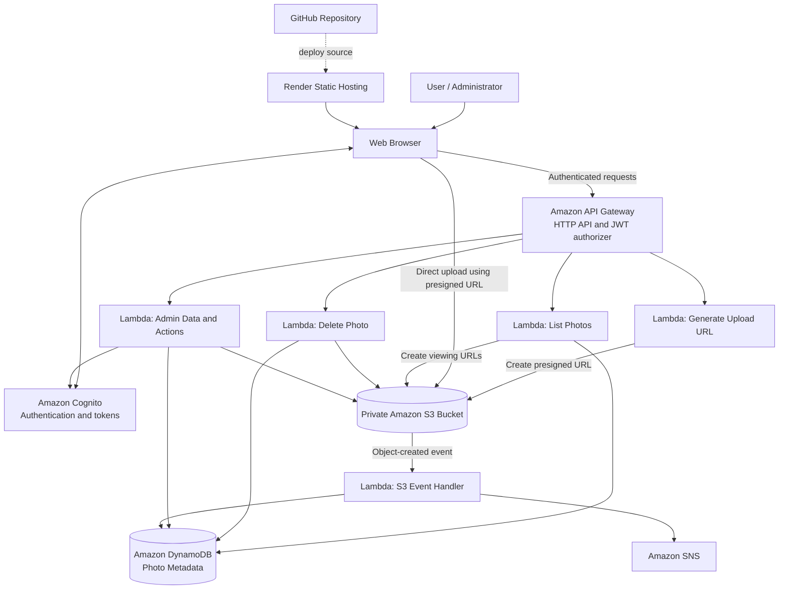

                   PhotoShare — AWS-Powered Photo Sharing Application
PhotoShare is a cloud-based photo-sharing web application built to demonstrate frontend development and AWS serverless services. Users can register or sign in, upload photos to private cloud storage, browse their gallery, and delete photos. Authorized administrators can access administrative features for managing users and photos.
Live website: https://photosharing-application.onrender.com/index.html
GitHub repository: https://github.com/Prasannadevii/PhotoSharing-Application
Table of Contents
- Project Overview
- Features
- Architecture
- Technology Stack
- How It Works
- Project Structure
- AWS Services
- Run Locally
- Configuration Notes
- Security Considerations
- Future Improvements
- Author
Project Overview
PhotoShare provides a simple interface for uploading and managing personal photos. The static frontend is hosted on Render and maintained in GitHub. AWS services provide authentication, API handling, image storage, metadata storage, and notifications.
The application uses presigned Amazon S3 URLs so the browser can upload image files directly to S3 instead of sending the file through the backend API.
Features
- User registration and sign-in with Amazon Cognito.
- Authenticated API requests using Cognito tokens.
- Upload JPEG, PNG, and WebP images (up to 10 MB in the frontend).
- Store uploaded images in a private Amazon S3 bucket.
- Retrieve and display a user's photo gallery.
- Delete photos from cloud storage.
- Mark photos as favourites and search the displayed gallery.
- Administrative dashboard and user-management actions for authorized administrators.
- S3-triggered processing to store photo metadata in DynamoDB and publish notifications through SNS.
- Responsive static frontend hosted on Render.
Availability of administrative actions depends on Cognito group membership and the configured backend permissions.

Architecture

Technology Stack
Area	Technology
Frontend	HTML, CSS, JavaScript
Source control	Git and GitHub
Static hosting	Render
Authentication	Amazon Cognito
API layer	Amazon API Gateway HTTP API
Backend compute	AWS Lambda (Node.js and Python, depending on function)
Image storage	Amazon S3
Metadata database	Amazon DynamoDB
Notifications	Amazon SNS
Authorization	Cognito tokens, API Gateway JWT authorizer, and backend authorization checks

How It Works
1. Sign up and sign in
1. The user opens the website.
2. Amazon Cognito handles registration and sign-in.
3. After authentication, the frontend receives tokens and uses them for protected API requests.
2. Upload a photo
1. The user chooses an image and enters a title.
2. The frontend sends an authenticated request to API Gateway for an upload URL.
3. A Lambda function generates a presigned S3 upload URL.
4. The browser uploads the image directly to the private S3 bucket.
5. An S3 event invokes the configured Lambda handler.
6. The handler stores photo metadata in DynamoDB and publishes a notification through SNS.
3. View the gallery
1. The frontend calls the photo-list API with the user's token.
2. The backend retrieves the user's photo metadata from DynamoDB.
3. The backend provides temporary viewing URLs for the stored images.
4. The frontend renders the gallery.
4. Delete a photo
1. The user requests deletion from the gallery.
2. The frontend sends an authenticated request to the delete API.
3. The backend checks authorization and deletes the S3 object and its corresponding metadata.
5. Administrator actions
An authorized administrator can use the admin interface to view dashboard information and perform supported user-management and photo-management actions. These operations rely on Cognito group membership and appropriate Lambda execution-role permissions.
Project Structure
Photo-Sharing/
├── index.html          # Main PhotoShare page
├── about-me.html       # About the author
├── about-website.html  # About the application
├── admin.html          # Admin dashboard
├── style.css           # Frontend styling
├── app.js              # Frontend logic and AWS API integration
├── Prasanna_Devi.jpeg  # Profile image used by the site
├── .gitignore          # Files excluded from Git
└── README.md           # Project documentation
AWS Lambda function source files and deployment packages may be maintained separately from the public frontend repository.
AWS Services
Amazon Cognito
Provides user registration, sign-in, and tokens for authenticated API requests. The configured app client uses the OAuth authorization-code flow with PKCE.
Amazon API Gateway
Exposes HTTP API routes and forwards requests to Lambda functions. A JWT authorizer can protect routes that require authentication.
AWS Lambda
Runs backend operations without requiring a continuously running server, including upload URL generation, photo listing and deletion, administrative actions, and S3 event processing.
Amazon S3
Stores image files in a private bucket. CORS must allow the deployed website origin for browser-based uploads. Presigned URLs provide time-limited access to specific operations or objects.
Amazon DynamoDB
Stores photo metadata, including identifiers and S3 object keys, so the application can retrieve and manage gallery entries.
Amazon SNS
Publishes notifications from the configured S3 event-processing Lambda. Actual delivery depends on SNS topic subscriptions and permissions configured in AWS.
Run Locally
Prerequisites
- Git
- Python 3 (for a simple local static server)
- Access to the configured AWS backend resources, if testing cloud features
Steps
1. Clone the repository:
   git clone https://github.com/Prasannadevii/PhotoSharing-Application.git
   cd PhotoSharing-Application
2. Start a local static server:
   python -m http.server 8000
3. Open the site at:
   http://localhost:8000/index.html
4. To test authentication locally, ensure http://localhost:8000/index.html is registered as an allowed callback URL and sign-out URL in Cognito.
5. Ensure the local origin http://localhost:8000 is allowed in relevant S3 and API CORS configurations if local browser requests need to access those services.
The frontend alone does not create the AWS backend. Cloud features require the relevant Cognito app client, API Gateway routes, Lambda functions, S3 bucket, DynamoDB table, SNS topic, permissions, and CORS settings.

Configuration Notes
The frontend contains public configuration values such as the Cognito app client ID, Cognito domain, API Gateway base URL, and redirect URL. If you fork or redeploy the project, update these values to match your own AWS resources.
- Use the exact deployed URL in Cognito's allowed callback and sign-out URL settings.
- Configure API Gateway and Lambda CORS to allow the intended frontend origin.
- Configure S3 bucket CORS to allow the intended browser origin and required methods.
- Keep the S3 bucket private and grant access through least-privilege IAM permissions and presigned URLs.
- Do not commit AWS access keys, secret keys, session tokens, private credentials, or .env files to GitHub.
Security Considerations
- Keep uploaded photos in a private S3 bucket.
- Use short-lived presigned URLs and avoid sharing them publicly.
- Protect administrative endpoints with backend authorization checks; hiding admin links in the frontend is not sufficient.
- Follow the principle of least privilege for Lambda execution roles.
- Review AWS billing and usage regularly.
- Do not store secrets in frontend JavaScript, because frontend code is publicly accessible.
Future Improvements
- Add automated tests for authentication, uploads, gallery retrieval, and deletion.
- Add file-size and file-type validation on the backend as well as the frontend.
- Add pagination and stronger rate limiting for API routes.
- Improve monitoring and error reporting with Amazon CloudWatch.
- Add CI/CD checks and a documented deployment process.
- Add accessibility and cross-browser testing.
Author
Prasannadevi S
PhotoShare was created as a hands-on cloud project to learn frontend development, serverless architecture, and integration of AWS services.
